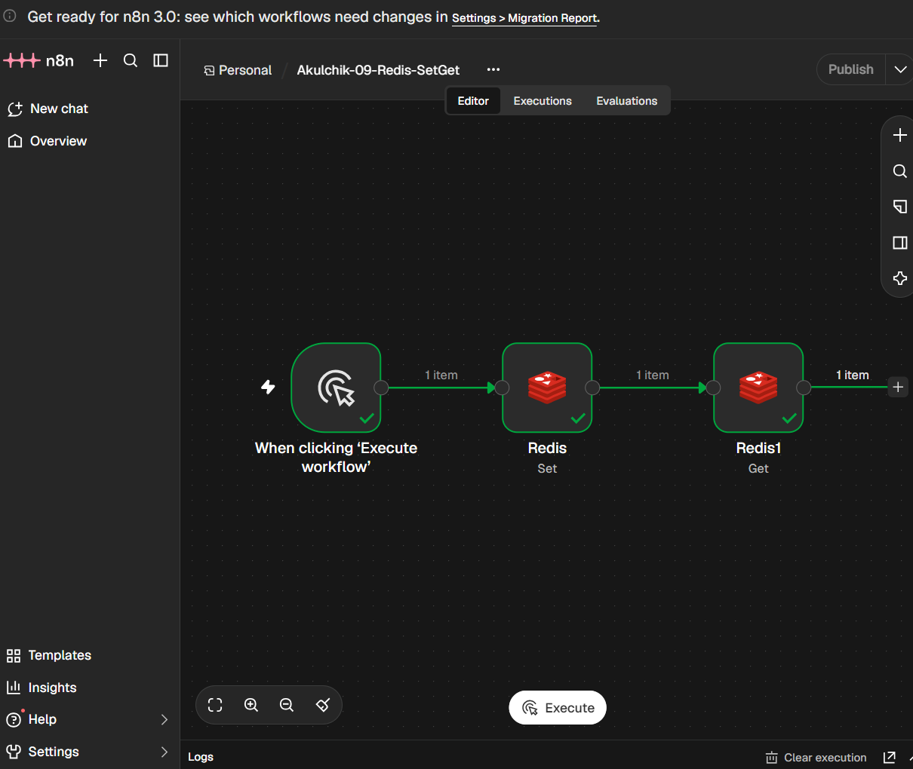
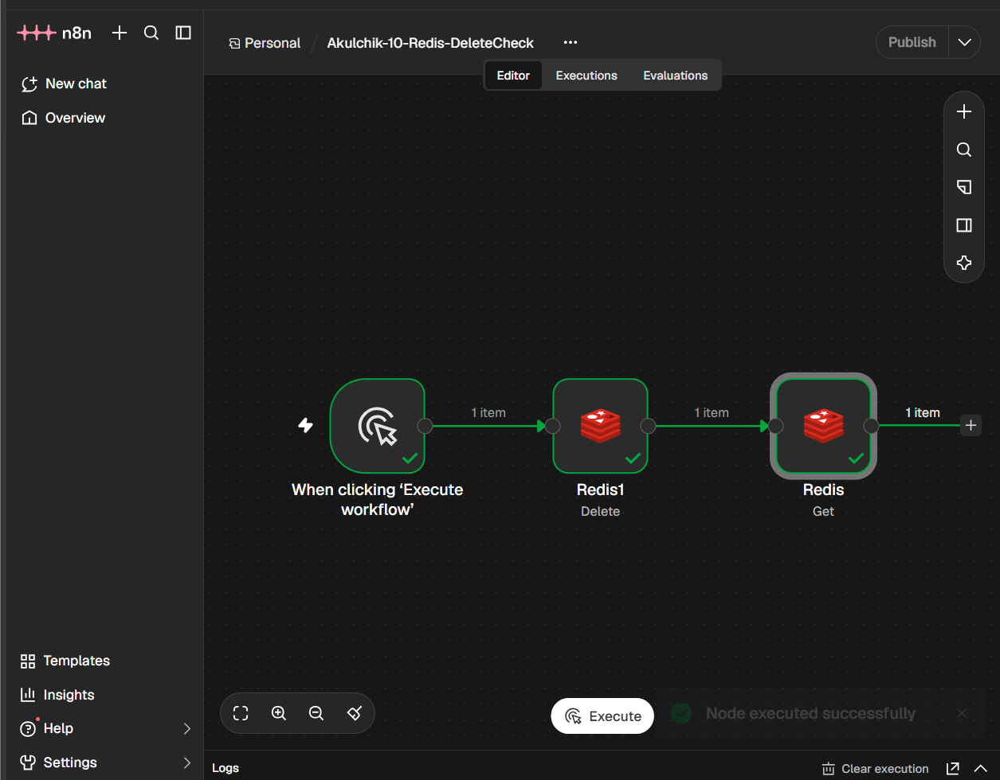

# Redis в n8n

## Запуск Redis
Redis запущен через Docker командой:
`docker run -d --name redis-akulchik -p 6379:6379 redis:7`

## Настройка Credentials
В n8n созданы credentials для Redis со следующими параметрами:
- Host: `host.docker.internal`
- Port: `6379`
- Database: `0`
- Password: (пусто)

## Workflow 9: создание и чтение ключа
В workflow используются две ноды Redis:
1. **Set the value of a key in redis** — создаёт ключ `akulchik` со значением `Hello from Akulchik Lab4`.
2. **Get the value of a key from Redis** — читает значение по ключу `akulchik`.

Значение успешно записывается и считывается.

## Workflow 10: удаление и проверка
В workflow используются две ноды:
1. **Delete a key from Redis** — удаляет ключ `akulchik`.
2. **Get the value of a key from Redis** — пытается прочитать ключ, но возвращает пустоту (или ошибку), что подтверждает успешное удаление.

