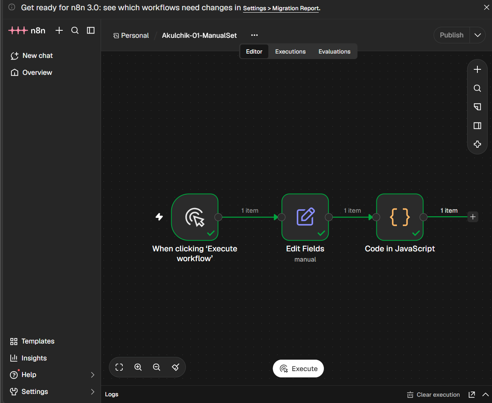
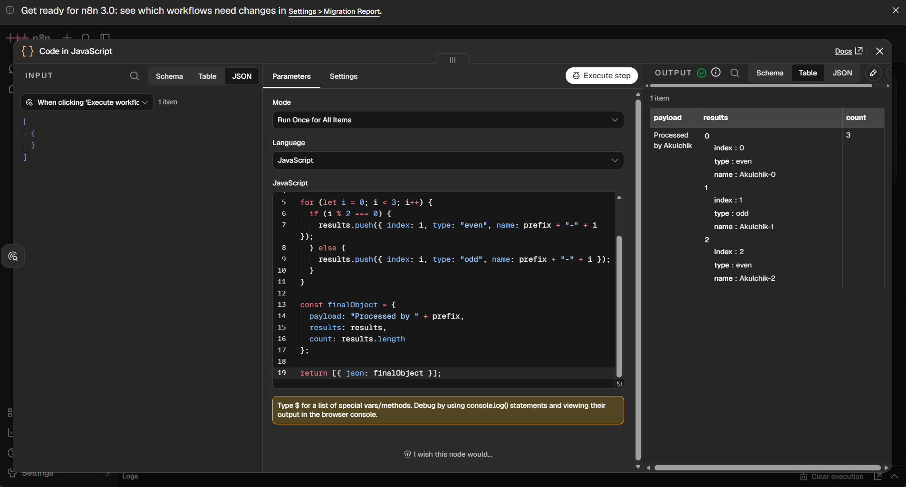
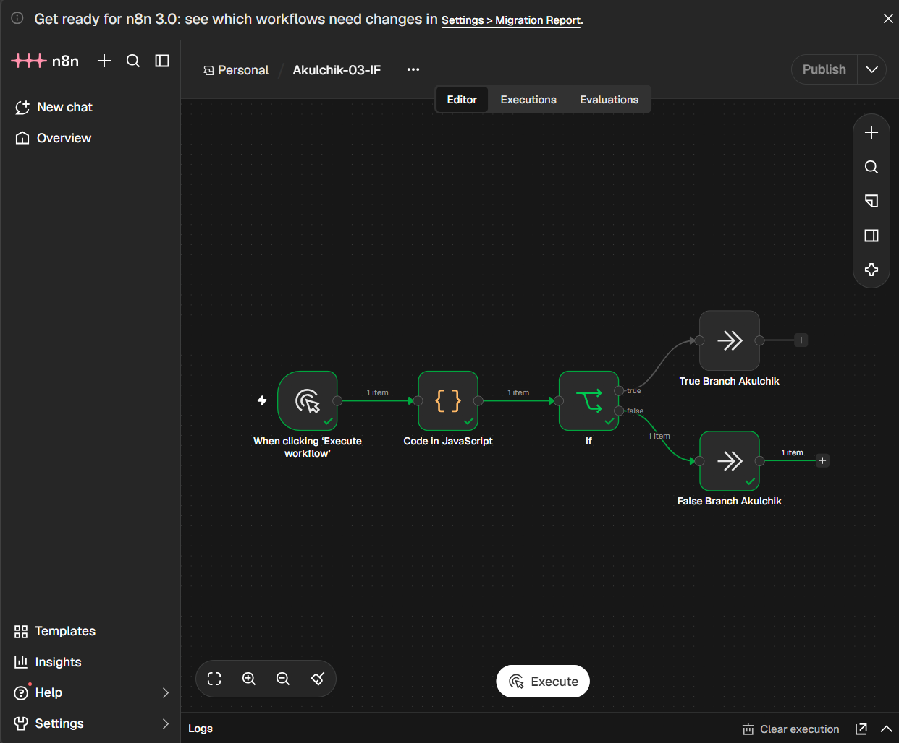
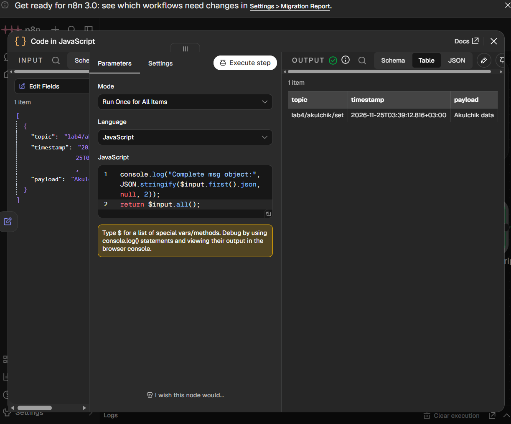
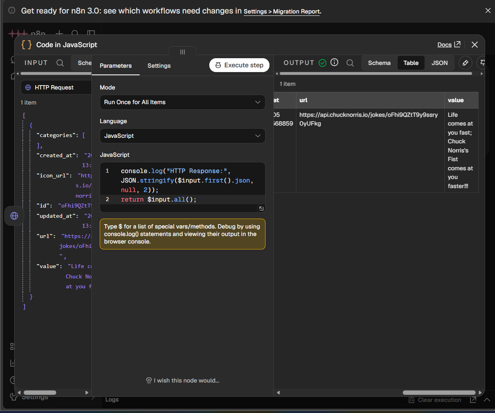
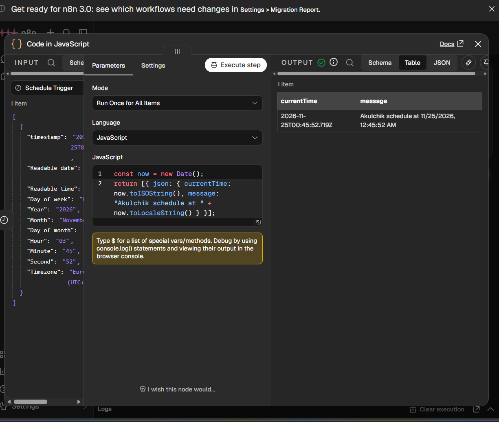
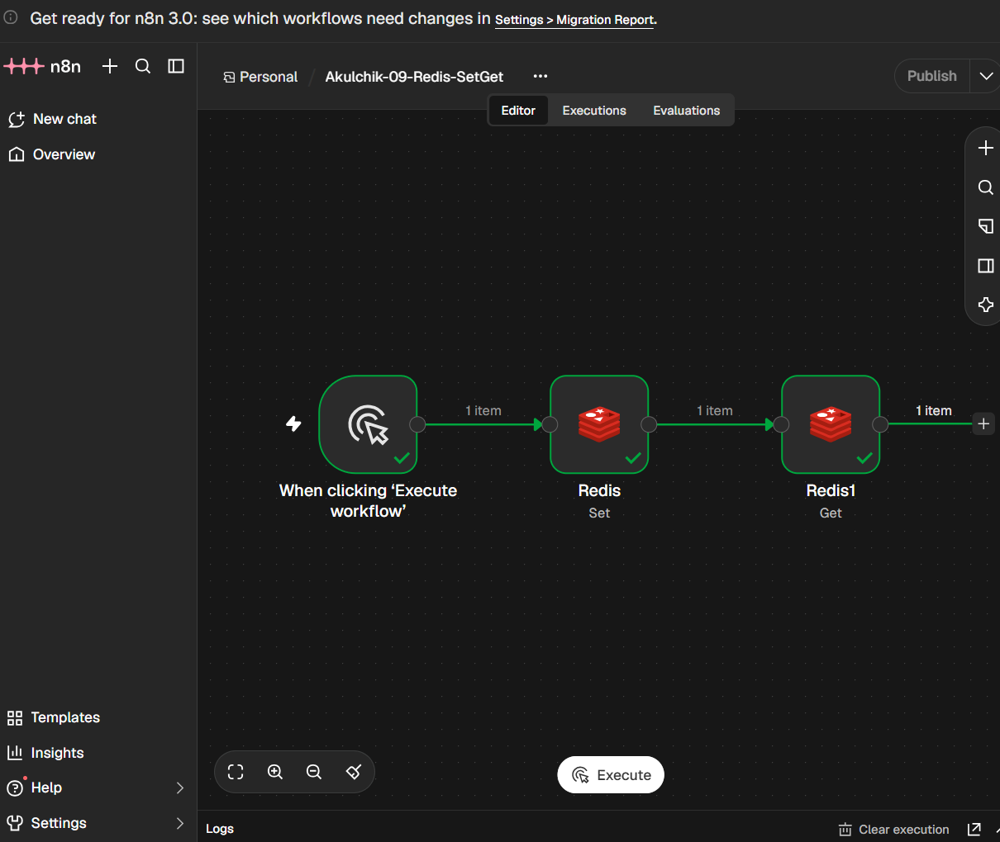
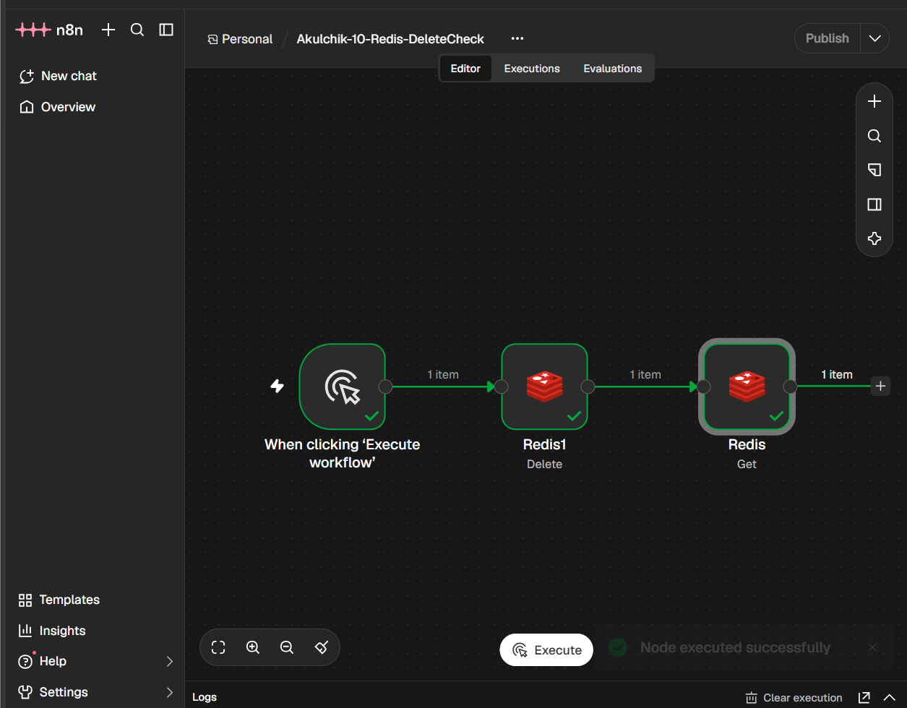
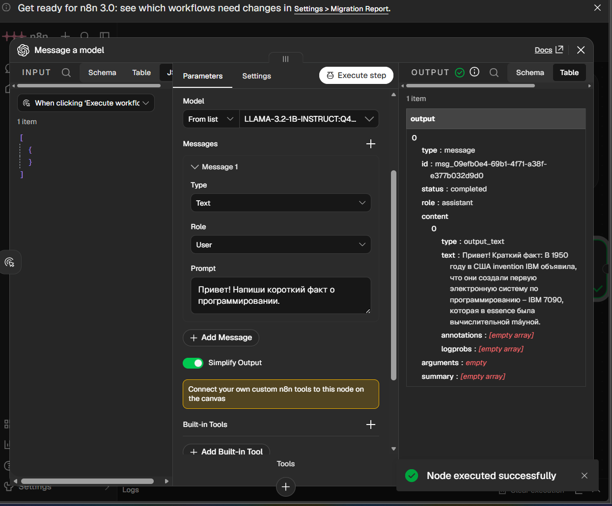

# Лабораторная работа №4. n8n

**Студент:** Акульчик
**Репозиторий:** visual-programming-labs-akulchik

## 1. Установка n8n
n8n запущен в Docker командой:
`docker run -it --rm --name n8n-akulchik -p 5678:5678 -e GENERIC_TIMEZONE="Europe/Moscow" -e TZ="Europe/Moscow" -v ~/n8n-data-akulchik:/home/node/.n8n -v ~/n8n-files-akulchik:/data n8nio/n8n`

Использованы два volume: для данных n8n (`/home/node/.n8n`) и для файлов (`/data`). Порт 5678.

## 2. Освоенные ноды
Manual Trigger, Set, Code, IF, HTTP Request, Schedule Trigger, Redis.

## 3. Скриншоты workflow

## 4. Использованные AI-промпты
- «Как запустить n8n в Docker с двумя volume?»
- «Пример JavaScript в n8n Code node с циклом for и if/else»
- «Как настроить Redis credential в n8n при запуске в Docker?»

## 5. Выводы
Я освоил n8n как low-code платформу: научился запускать в Docker, соединять ноды в цепочки, работать с данными через Set и Code, делать ветвления через IF, обращаться к внешним API через HTTP Request, запускать по расписанию через Schedule Trigger и работать с Redis (Set/Get/Delete). Понял, что n8n позволяет быстро автоматизировать задачи без написания полноценного приложения.
## Ачивка: Подключение LocalAI

Для выполнения ачивки была использована программа **LocalAI** (не входит в список Ollama/LM Studio/Jan/GPT4All).

1. LocalAI запущен в Docker: `docker run -p 8080:8080 --name local-ai -ti localai/localai:latest`.
2. Внутри LocalAI установлена модель `tinyllama`.
3. В n8n созданы credentials типа OpenAI с Base URL `http://host.docker.internal:8080/v1`.
4. Собран workflow: Manual Trigger → OpenAI (Chat) → ответ от локальной модели.

Скриншот: 