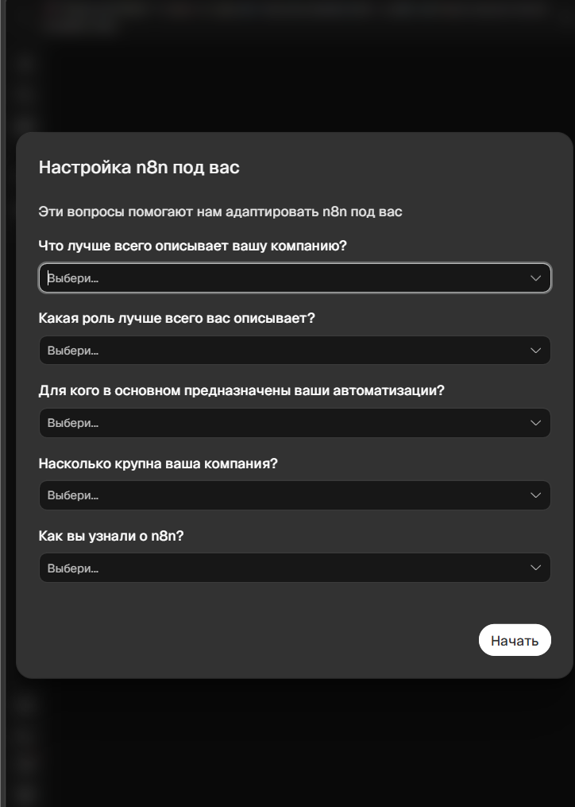

# Лабораторная работа №4. n8n

**Студент:** Акульчик
**Репозиторий:** visual-programming-labs-akulchik

## 1. Установка n8n
n8n запущен в Docker командой:
`docker run -it --rm --name n8n-akulchik -p 5678:5678 -e GENERIC_TIMEZONE="Europe/Moscow" -e TZ="Europe/Moscow" -v ~/n8n-data-akulchik:/home/node/.n8n -v ~/n8n-files-akulchik:/data n8nio/n8n`

Использованы два volume: для данных n8n (`/home/node/.n8n`) и для файлов (`/data`). Порт 5678.

